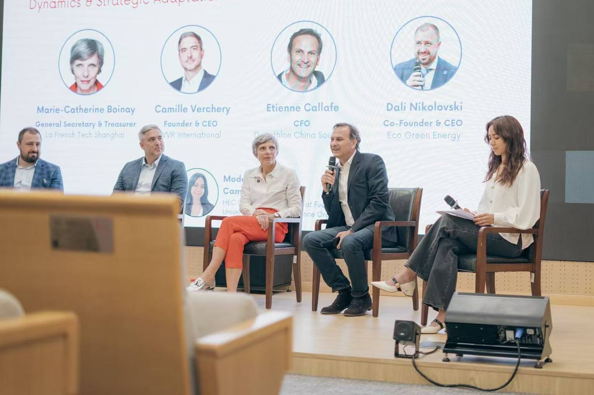
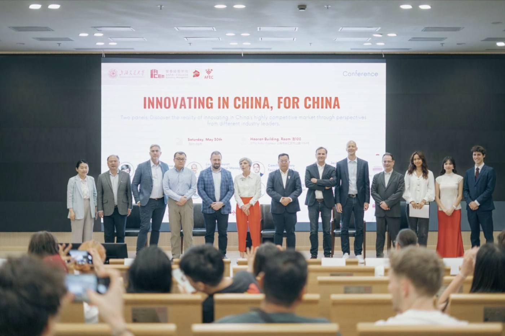

# Events portfolio

The events I have designed and run, mostly around health and AI.

## Human Layer: defence & health hackathon (MedInTechs 2027)

Co-lead. A 24-hour hackathon for 48 students on the health of frontline workers, run with MedInTechs.

- Designed the scenario, rules, jury and prizes; co-wrote the 20-page partner proposal
- Raising €19–31k through a 3-tier sponsorship offer; outreach to Safran, Thales and Dassault Systèmes
- [Read the partner proposal (PDF, in French)](human-layer-dossier.pdf)

## Innovating in China, For China (SJTU, Shanghai, 30 May 2026)

AFEC × SJTU Antai conference: 150+ attendees, 8 speakers, 2 roundtables. I organised and moderated a roundtable with executives, including the CFO of Decathlon China.

| | |
|---|---|
|  |  |

## HEC IA

- **Dinners**: programme of dinners with CEO-level guests from Bain & Company, Safran AI and AMI Labs
- **Hackathons**: 50 participants per edition
- **AI career fair**: 30 AI companies

## MedX

Head of Events of the health association of HEC Paris.
